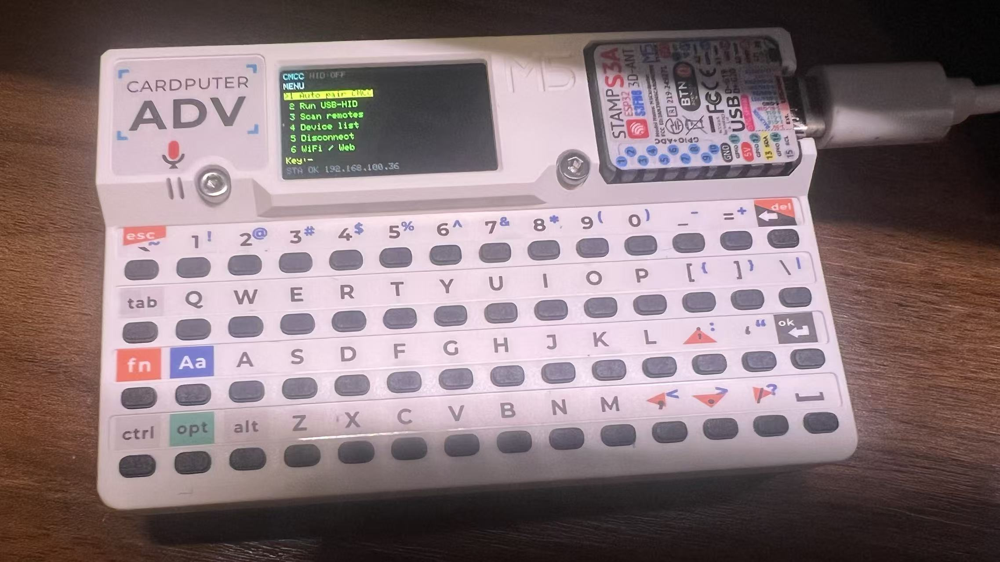
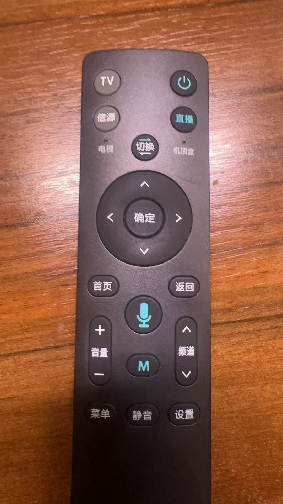
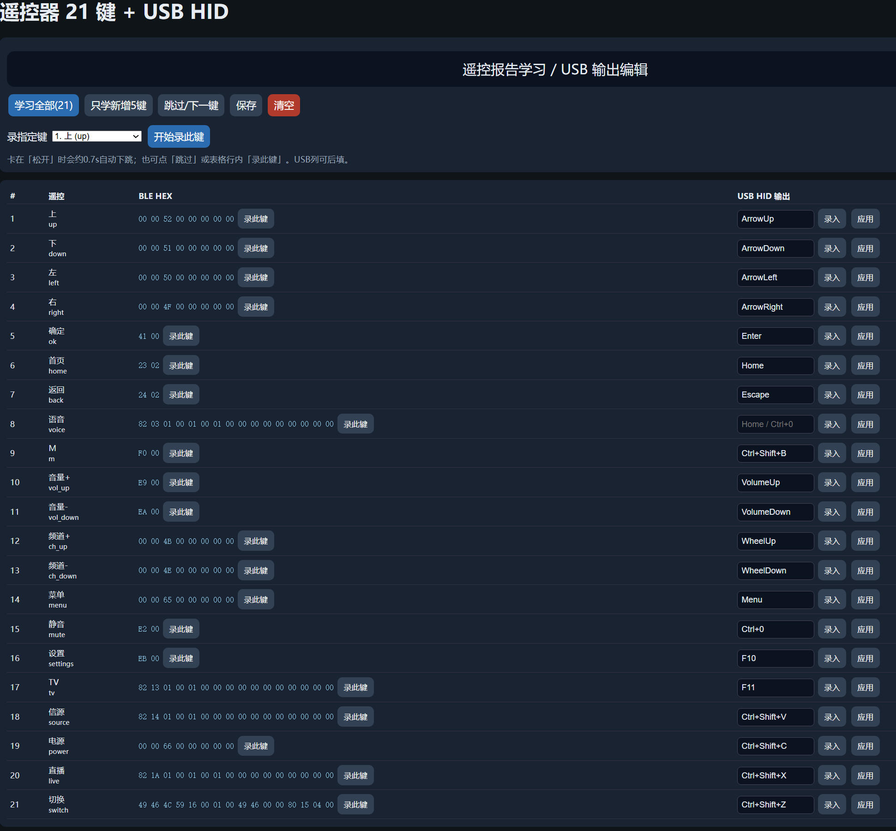

# CMCC_Voice_Remote · VibeCoding

> 中国移动机顶盒语音遥控 → **ESP32**（BLE + USB HID）→ Windows 键盘 / 语音听写  
> 刷红果短剧、抖音 · 配合微信输入法做语音 AI 编程

把普通**中国移动机顶盒语音遥控器**（`CMCC_Voice_Remote`）接到电脑：用一块 **ESP32**（本仓库参考实现跑在 **M5Stack Cardputer ADV / ESP32-S3**）做桥梁——按键映射成 Windows USB 键盘/多媒体键，语音经串口落到 PC 再解码成 WAV。

**本方案不绑定 ADV。** 核心是「ESP32 当 BLE Central + USB HID 复合设备」；StampS3、DevKit、其它 ESP32-S3 / 带原生 USB 的板子都可参考移植（改引脚、屏/键盘即可）。仓库提供的现成 `.bin` 面向 Cardputer ADV，其它板请自行编译。

典型用法：

- **刷剧刷抖音**：PC 开 **雷电 / MuMu / 蓝叠** 等安卓模拟器，远距离刷 **红果短剧、抖音**——方向键切集/上下滑，确定进入，返回退出。
- **语音 AI 编程**：配合 **微信输入法** 听写，对着遥控说话，把提示词打进 **Cursor / ChatGPT / 聊天窗**（见下文）。

不必买网上很火的「小米遥控器 2 Pro」。
 
| 参考实现：Cardputer ADV | CMCC 语音遥控器 |
|:---:|:---:|
|  |  |

```
CMCC_Voice_Remote  --BLE-->  ESP32 (ADV 参考实现)  --USB HID-->  Windows 键盘/多媒体
                                      |--USB CDC-->  串口语音帧 → tools/voice → WAV
                                      |--WiFi----->  网页配置 / 按键学习
```

## 硬件与环境

| 项目 | 说明 |
|------|------|
| 方案 | 任意能跑 BLE Central + USB Device 的 **ESP32**（推荐 ESP32-S3 原生 USB） |
| 参考板 / 现成固件 | Cardputer ADV（ESP32-S3，8MB Flash）——Releases 里的 bin 针对此板 |
| 遥控器 | 中国移动机顶盒标配语音遥控，BLE 名多为 `CMCC_Voice_Remote` |
| PC | Windows；刷机工具（见下）；可选串口监视器 **115200** |
| 可选 | TF 卡（日志 + 键位备份；ADV 上有卡槽） |

## 下载与刷机（普通用户）

**不必自己编译（ADV 用户）。** 请到 **[Releases](https://github.com/miaolink/CMCC_Voice_Remote_VibeCoding/releases)** 下载最新发布包，解压后刷入 ADV。其它 ESP32 板请 clone 源码改板级配置后自行编译。

发布包通常包含：

| 文件 | 用途 |
|------|------|
| `cmcc-ble-bridge-menu.bin` | **推荐**：带菜单的当前固件 |
| `cmcc-ble-bridge-arrows.bin` | 早期仅方向键版（可选） |
| `cmcc-keymap-default.json` | 键位参考（可选） |

刷机方式任选其一：

1. **M5Burner**：选 Cardputer ADV / ESP32-S3，选中上述 `.bin` 烧录。  
2. **本机已有 Launcher**：把 bin 拷到 SD，用 Launcher 安装应用固件。  
3. **esptool**（熟悉命令行时）：按发布说明里的地址/偏移写入。

刷本固件会覆盖 Cardputer 当前 Launcher；要用回原系统，请另行刷官方 / M5Burner 的 Launcher。

> 仓库 `firmware/` 有同名副本便于查阅，**日常请以 Releases 包为准**。

## 功能概览

- **BLE 中继**：扫描 / 自动配对 CMCC 遥控，订阅 HID report
- **USB HID**：方向键、确定、首页、返回、音量、频道滚轮、快捷键组合等
- **21 键学习**：Web 页按提示录制 BLE 报文，并绑定 USB 输出（键盘 / Consumer / 鼠标滚轮）
- **语音**：按住语音键（PTT）开麦；CDC 落 WAV；配合 **微信输入法** 可做听写 / 语音 AI 编程
- **WiFi Web**：STA 入网或 AP 热点；浏览器控制配对、HID、键位、MIC 探测

语音键默认**不**发 USB HID（仅 PTT / 开麦）。听写快捷键请在 `/learn` 自行绑定，见「微信输入法」一节。

## 安卓模拟器（红果 / 抖音等）

ADV 对电脑表现为普通 USB 键盘，模拟器窗口在前台时即可用遥控操作，无需额外驱动。

| 场景 | 建议 |
|------|------|
| 红果短剧、长视频 | 方向键选剧/切集，确定播放，返回退出；音量± 调系统或模拟器音量 |
| 抖音 / 短视频流 | 上/下 或 频道±（默认滚轮）刷下一条；确定点赞/进详情（视 App 焦点而定） |
| 语音搜剧 / 听写 | 配合微信输入法，见下一节 |

要点：

1. 先 **Run USB-HID**，再点一下模拟器窗口确保焦点在模拟器内。
2. 不同模拟器对方向键 / 滚轮的响应略有差异；不合适可到网页 `/learn` 改 USB 映射（例如把频道± 改成 `ArrowUp`/`ArrowDown` 或 `PageUp`/`PageDown`）。
3. 部分 App 需在模拟器设置里打开「键鼠映射」或把方向键绑到滑动手势。

## 微信输入法：语音写代码 / 开聊天

目标：躺着对遥控说话 → 文字进 Cursor Agent、聊天框或任意输入框，用来 **语音输入 AI 编程**、**打开/回复聊天**。

### 1. 装好微信输入法

1. 安装 [微信输入法](https://z.weixin.qq.com/)，设为 Windows 默认输入法。
2. 打开输入法设置 → **语音输入**：打开语音、选好麦克风、记下（或自定义）**语音快捷键**（常见为点麦图标，或自定义如 `Alt+B` / `Ctrl+Shift+V` 等，以你本机设置为准）。
3. 任务栏输入法图标切到「微信」，确认任意文本框能弹出候选栏。

### 2. 麦克风从哪来

| 方案 | 说明 |
|------|------|
| **A. PC 麦克风 / 耳机麦**（最省事） | 微信输入法直接采电脑麦；人靠近电脑或外接麦说话。遥控只负责 **快捷键开听写 + 方向/确认**。 |
| **B. 遥控麦 → WAV**（当前固件主路径） | 按住遥控语音键，ADV 经 CDC 吐帧；PC 跑 `tools/voice` 出 WAV。适合留档/调试，**还不等于**实时进输入法。 |
| **C. USB 麦克风 UAC**（规划中） | 板端把解码 PCM 枚举成系统麦克风，微信输入法选该设备即可边说边出字；见源码 `usb_audio_mic`，尚未作为默认能力。 |

日常 AI 编程推荐先走 **方案 A**：遥控当「无线键盘 + 一键开听写」，麦用电脑自带的。

### 3. 把遥控键绑到「听写 / 开聊天」

固件里 **语音键默认不发 USB HID**（只做 PTT 开麦，避免误触）。要用微信听写快捷键，请到网页 **`/learn`** 给某一键填 USB 标签，例如：

| 用途 | 建议遥控键 | USB 标签示例 | 说明 |
|------|------------|--------------|------|
| 开微信语音听写 | 另选一键（如 **M** / **切换**），或给语音键单独绑快捷键* | `Alt+B`（改成你在输入法里设的快捷键） | 按下 = 触发听写；说完再按一次结束（视输入法设置） |
| 打开 Cursor Chat / Agent | **切换** / **直播** 等闲置键 | 与 Cursor 快捷键一致，如 `Ctrl+L` / `Ctrl+I`（以 Cursor 设置为准） | 先开聊天面板，再听写提示词 |
| 打开微信 PC 聊天 | 任意闲置键 | 可绑微信全局快捷键，或 `Ctrl+Alt+W` 等你自己设的 | 焦点进聊天输入框后再听写 |

\*若希望「按住语音键 = 开麦 + 同时触发听写」，需在 `/learn` 给 `语音` 填上与微信输入法相同的快捷键；注意与 PTT 开麦并存时，方案 A 通常只需要快捷键、不需要 CDC 音频。

默认表里已有一批组合键（`Ctrl+Shift+B/V/C/X/Z`、`F10`/`F11` 等），可按自己的 Cursor / 微信快捷键在 `/learn` 里改掉。

### 4. 推荐操作流（语音 AI 编程）

1. ADV：**Auto pair CMCC** → **Run USB-HID**。
2. PC：切到 **微信输入法**；打开 **Cursor**（或 ChatGPT / 对话网页）。
3. 遥控按「开聊天」键 → 光标进 Agent / Chat 输入框。
4. 按「听写」快捷键（或你映射的那颗键）→ 说话写需求 → 结束听写 → **确定** 发送。
5. 用方向键在补全/文件树里挪光标，**返回** 当 Escape 关掉面板。

同一套流程也可用于：微信里回消息、浏览器搜索框、红果/抖音里搜剧名（焦点在输入框时）。

## 快速上手

1. 从 **[Releases](https://github.com/miaolink/CMCC_Voice_Remote_VibeCoding/releases)** 下载固件并刷入 ADV（见上节）。
2. 在 Windows「蓝牙和其他设备」里 **删除/忽略** `CMCC_Voice_Remote`（避免 PC 与 ADV 抢连）。
3. ADV 用 USB 连电脑；设备管理器应出现 **键盘**（以及 CDC 串口）。屏上出现 `CMCC` 菜单即成功。
4. 本机菜单选 **1 Auto pair CMCC**，或连上 WiFi 后打开网页点「自动配对 CMCC」；换电池 / 长按配对键并靠近 ADV。
5. 屏上出现 `found` → `connected` → 再选 **2 Run USB-HID**（或网页「Run HID」）。
6. 按方向键等：Windows / 模拟器光标应移动。

### 本机键盘（Cardputer）

| 键 | 作用 |
|----|------|
| `;` / `.` | 上 / 下移动光标 |
| Enter / 空格 | 确认 |
| `` ` `` / Backspace | 返回 |
| `s` | 扫描 |

### 屏上主菜单

1. Auto pair CMCC  
2. Run USB-HID  
3. Scan remotes  
4. Device list  
5. Disconnect  
6. WiFi / Web（状态页）

## 默认按键映射

固件内置 21 键默认 BLE 指纹 + USB 输出（可学习覆盖，存 Preferences；有 SD 时亦可备份）。网页 **/learn** 示意：



| 遥控 | USB 输出 |
|------|----------|
| 上 / 下 / 左 / 右 | ArrowUp / Down / Left / Right |
| 确定 | Enter |
| 首页 | Home |
| 返回 | Escape |
| 语音 | （无 HID，仅 PTT） |
| M | Ctrl+Shift+B |
| 音量+ / − | VolumeUp / VolumeDown |
| 频道+ / − | 鼠标滚轮上 / 下 |
| 菜单 | Menu |
| 静音 | Ctrl+0 |
| 设置 | F10 |
| TV | F11 |
| 信源 | Ctrl+Shift+V |
| 电源 | Ctrl+Shift+C |
| 直播 | Ctrl+Shift+X |
| 切换 | Ctrl+Shift+Z |

键位参考 JSON 亦随 Releases 发布（部分标签可能偏旧，以固件当前默认为准）。

在网页 **/learn** 可逐键「录此键」、改 USB 标签（支持 `Ctrl+Shift+B`、`VolumeUp`、`WheelUp`、`F10` 等），再保存。

## WiFi / 网页

启动后异步连 STA；失败可开 AP。

| 模式 | 默认 |
|------|------|
| STA | `RongHe-wifi6` / `20202020`（可在网页改） |
| AP | `ADV-Bridge` / `bridge1234` → http://192.168.4.1 |

页面：

| 路径 | 用途 |
|------|------|
| `/` | 状态、BLE 配对/扫描、WiFi、HID 测试、日志 |
| `/learn` | 21 键学习与 USB 映射编辑 |
| `/voice` | MIC 抓包 / GATT 探测（调试用） |

## 语音 → WAV（PC，方案 B）

按住遥控语音键时，固件经 USB-CDC 输出：

```
# VOICE 1
A <40 hex of 20B GATT notify>
...
# VOICE 0
# A END
```

PC：拼帧 → ICO 解白化 → G.722.1（16 kbps）→ 16 kHz mono WAV。

```bat
pip install pyserial
cd tools\voice
python voice_cap.py list
python voice_cap.py COM3 --auto
```

按住语音键说一句，松手约 2.5 秒后生成 `out\voice_*.wav`。详见 [tools/voice/README.md](tools/voice/README.md)。

> 实时进微信输入法请优先用上一节 **方案 A**；UAC 虚拟麦（方案 C）仍在规划，当前以 CDC + PC 解码落盘为主。

## 注意与排障

- **抢连**：PC 已配对同一遥控时，ADV 往往连不上——先在系统蓝牙里忽略该设备。
- **先配对再开 HID**：菜单顺序建议 Auto pair → Run USB-HID。
- **未匹配按键**：串口会打 raw/hex；到 `/learn` 补录即可。
- **设置键**：旧映射 Consumer `0x0183` 会弹 Windows 媒体播放器，已默认改为 F10，并加防护。
- **语音不断流**：确认已连上遥控并按住语音键；用 `/voice` 看 `fc_like` / pps，或串口是否出现 `# VOICE 1` 与 `A ...` 行。
- **许可证**：仓库主体为 MIT；`tools/voice/` 中源自 [cmcc-voice-remote-bridge](https://github.com/jackielozet/cmcc-voice-remote-bridge) 的解码相关文件，以及 `decode.exe` / libg7221，为 **GPL-2.0**（独立进程调用）。详见下方「第三方与许可证」。

---

## 第三方与许可证

- **本仓库主体**：MIT（[`LICENSE`](LICENSE)）。
- **GPL-2.0 部分**（声明与文件清单）：
  - [jackielozet/cmcc-voice-remote-bridge](https://github.com/jackielozet/cmcc-voice-remote-bridge)：`tools/voice/voice_bridge.py`、`audio_decode_summary.md`、`libg722_1-v0.2.0-debug-globals.patch`，以及衍生的 `decode_main.c`、`lib/g7221/src/decoder.c`（打补丁后）。完整说明见 [`tools/voice/NOTICE`](tools/voice/NOTICE)、[`tools/voice/LICENSE`](tools/voice/LICENSE)。
  - [freeswitch/libg7221](https://github.com/freeswitch/libg7221)：`tools/voice/libg7221/`、`lib/g7221/`、`decode.exe`（独立进程）。

---

## 开发者：自行编译 / 移植其它 ESP32（可选）

ADV 普通用户请用 Releases 固件，无需本节。

需 [PlatformIO](https://platformio.org/)。在本仓库根目录（ADV 环境）：

```bash
pio run -e cardputer-adv
pio run -e cardputer-adv -t upload --upload-port COMx
pio device monitor -b 115200 --port COMx
```

也可 `flash.bat COMx`。

移植到其它 ESP32 时，优先改：

- `platformio.ini`：board / flash / `build_flags`（USB CDC/HID）
- 屏与键盘驱动（`display_ui` / `kb_input`）——无屏也可只靠串口 + Web
- USB：推荐 **ESP32-S3** 原生 Device；经典 ESP32 需外接 USB-UART 或改方案

BLE（NimBLE）+ 键位学习 + WiFi Web 与板型无关，可直接复用。

打发布包：把 `.pio/build/cardputer-adv/firmware.bin` 重命名为 `cmcc-ble-bridge-menu.bin`（及可选 keymap）上传到 [Releases](https://github.com/miaolink/CMCC_Voice_Remote_VibeCoding/releases)。

## 目录结构

```
CMCC_Voice_Remote_VibeCoding/
  src/ include/     固件源码
  lib/g7221/        板端编解码（GPL，可选）
  tools/voice/      PC 抓包与 decode.exe
  firmware/         预编译 bin 副本
  platformio.ini
  ADV.jpg  cmcc.jpg
```
